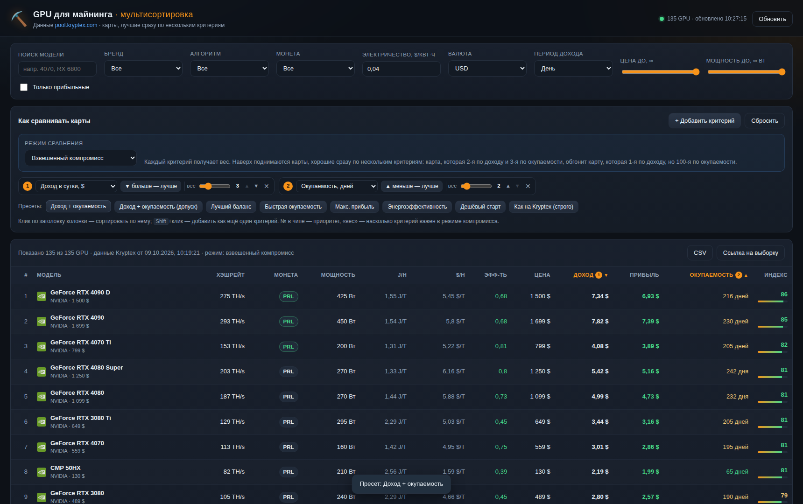
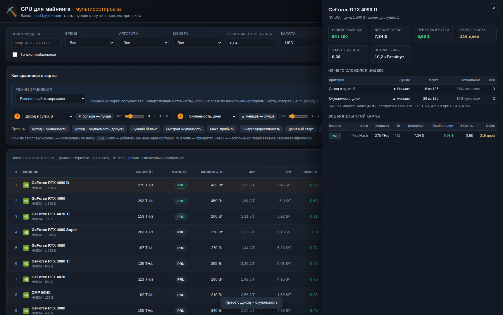

# Kryptex GPU — мультисортировка

Веб-таблица видеокарт для майнинга на живых данных [Kryptex](https://pool.kryptex.com/ru/device/gpu),
которая умеет то, чего нет в оригинале: **показывать карты, лучшие сразу по нескольким критериям**
(доход, хэшрейт, мощность, окупаемость, прибыль, эффективность).



## Установка одной командой

```bash
git clone <repo-url> kryptex-gpu-multisort
cd kryptex-gpu-multisort
./install.sh
```

Скрипт сам поставит Node.js (если его нет), подберёт свободный порт, зарегистрирует
сервис с автозапуском и проверит, что всё отвечает. В конце напечатает адрес вида
`http://127.0.0.1:8099`.

Подробности, опции и решение проблем — в [docs/DEPLOY.md](docs/DEPLOY.md).

```bash
./install.sh --port 9000      # свой порт
./install.sh --host 0.0.0.0   # доступ из локальной сети
./install.sh --update         # обновить и перезапустить
./install.sh --uninstall      # остановить и удалить сервис
```

Без установки, просто запустить:

```bash
node server.mjs               # → http://127.0.0.1:8099
```

Зависимостей времени выполнения нет — только Node.js 18+.

## Зачем это, если есть Kryptex

У Kryptex критерий сортировки всегда один. Даже если добавить второй, работает
**строгая лексикографическая** сортировка: второй критерий участвует, только когда
значения первого совпали *абсолютно точно*. На реальных данных это не происходит никогда.

Результат — таблица показывает датацентровые карты за $40 000:

| # | карта | доход/сут | прибыль/сут | окупаемость |
|---|---|---|---|---|
| 1 | DGX B200 | 32,02 $ | 31,10 $ | **1 286 дней** |
| 2 | DGX B300 | 22,68 $ | 21,72 $ | **2 302 дня** |
| 3 | H200 | 18,81 $ | 18,23 $ | **1 920 дней** |

Формально «самый большой доход», практически — покупать нечего.

## Три режима сравнения

### 1. Взвешенный компромисс (по умолчанию)

Каждый критерий получает **вес** (ползунок 1–10 рядом с чипом). Для каждой карты
считается перцентильный ранг по каждому критерию (0 — лучшая в выборке, 1 — худшая),
затем взвешенное среднее → **индекс баланса** от 0 до 100.

```
score  = Σ (вес × ранг) / Σ весов
индекс = 100 × (1 − score)
```

Поэтому карта, которая 2-я по доходу и 3-я по окупаемости, обгонит карту,
которая 1-я по доходу, но 100-я по окупаемости. Вторичный критерий реально работает.

Тот же пример «самый большой доход + окупаемость»:

| # | карта | доход/сут | окупаемость | индекс |
|---|---|---|---|---|
| 1 | GeForce RTX 4090 D | 7,34 $ | 216 дней | 86 |
| 2 | GeForce RTX 4090 | 7,82 $ | 230 дней | 85 |
| 3 | GeForce RTX 4070 Ti | 4,08 $ | 205 дней | 82 |
| 4 | GeForce RTX 4080 Super | 5,42 $ | 242 дня | 81 |
| 5 | GeForce RTX 4080 | 4,99 $ | 232 дня | 81 |

Индекс виден в отдельной колонке; при наведении — расшифровка, а в карточке карты —
таблица «Из чего сложился индекс» с местом по каждому критерию.



### 2. Допуск от лучшего

Берутся лучшие карты по критерию №1; всё, что укладывается в **допуск** к лучшему
значению (по умолчанию 10%), считается равным и сортируется по следующим критериям.
Буквальная реализация «самые доходные, отсортированные по окупаемости».

### 3. Строгий приоритет («Как на Kryptex»)

Классическая лексикографическая сортировка: критерий №1, при полном равенстве — №2.
Оставлен для сравнения и совместимости с оригиналом.

## Возможности

| Возможность | Kryptex | Здесь |
|---|---|---|
| Критериев одновременно | 1 | до 8, у каждого свой вес |
| Вторичный критерий влияет на порядок | — | да (режим компромисса) |
| Пресеты | — | 8 готовых, в т. ч. «Доход + окупаемость» |
| Фильтры | алгоритм, монета, бренд, $/кВт·ч | + поиск, цена, мощность, «только прибыльные» |
| Валюта | RUB | 32 валюты (курсы из payload Kryptex) |
| Период | день/месяц/год | день/месяц/год |
| Детализация | частично | все монеты карты + расшифровка индекса |
| Экспорт | — | CSV (с индексом) |
| Шаринг выборки | — | ссылка с состоянием в `#hash` |

Управление критериями: **клик по заголовку** — сортировать по полю,
**Shift+клик** — добавить как ещё один критерий; в чипе — поле, направление
(«больше — лучше» / «меньше — лучше»), вес, приоритет (▲▼) и удаление.

## Формулы (как на Kryptex)

Для «лучшей» монеты карты по `revenue_usd`:

```
потребление, кВт·ч/сут = мощность_Вт × 24 / 1000
расход на электричество = потребление × цена_$/кВт·ч
доход_сутки            = revenue_usd
прибыль_сутки          = доход_сутки − расход
эффективность          = прибыль_сутки / потребление   ($ на кВт·ч)
окупаемость, дней      = цена_карты / прибыль_сутки    (null, если прибыль ≤ 0)
```

Проверено против отрендеренных карточек Kryptex: CMP 50HX — 66 дней,
CMP 90HX — 95 дней, CMP 30HX — 100 дней (совпадает с сайтом).

## Откуда данные

`server.mjs` забирает `https://pool.kryptex.com/ru/device/gpu/_payload.json` —
Nuxt-payload в формате [devalue](https://github.com/Rich-Harris/devalue)
(плоский массив со ссылками по индексам). Сервер разворачивает его сам,
не завязываясь на хеш-ключи: массив видеокарт и таблицы курсов ищутся структурно,
поэтому пересборка фронтенда Kryptex парсер не ломает.

- 135 видеокарт, у каждой — список монет с хэшрейтом, мощностью, доходом
  в USD и в монете, `J/H` и `$/H`.
- Фолбэк на SSR-HTML той же страницы (`<script id="__NUXT_DATA__">`), если payload недоступен.
- Кэш в памяти 5 минут; при сбое апстрима отдаётся последняя удачная копия
  с пометкой «устаревшие данные».
- Принудительное обновление: `GET /api/data?refresh=1` или кнопка «Обновить».

## API

| Метод | Описание |
|---|---|
| `GET /` | веб-интерфейс |
| `GET /api/data` | `{ok, fetchedAt, upstreamLastModified, rates, rows[]}` |
| `GET /api/data?refresh=1` | то же с обходом кэша |
| `GET /api/health` | состояние кэша |

## Структура

```
server.mjs          backend: забор данных, devalue-парсер, кэш, API, раздача статики
public/index.html   разметка
public/app.js       метрики, три режима сравнения, фильтры, рендер, экспорт
public/style.css    оформление (тёмная тема)
install.sh          автоматическое развёртывание и установка зависимостей
run.sh              управление процессом: start | stop | restart | status
docs/DEPLOY.md      руководство по развёртыванию
test/verify.cjs     E2E-тесты в реальном DOM (jsdom)
test/browser.cjs    браузерная проверка и скриншоты (Playwright, опционально)
```

## Тесты

```bash
npm install      # jsdom
npm test         # 60+ проверок: режимы, веса, пресеты, фильтры, валюта, CSV
```

Тест сам поднимает сервер, если тот не запущен, и гасит его после прогона.
Порядок строк сверяется с независимым эталоном, посчитанным напрямую из `/api/data`,
а не с реализацией клиента.

Браузерная проверка (скриншоты, экспорт CSV, ошибки консоли):

```bash
npm i -D playwright && npx playwright install chromium
npm run test:browser
```

## Замечание про хэшрейт

Хэшрейт у разных алгоритмов измеряется в разных единицах (TH/s для SHA-256,
MH/s для Ethash и т. д.), поэтому сортировка по «сырому» хэшрейту сравнивает
разные величины — как и на самом Kryptex. Чтобы сравнение было корректным,
выберите конкретный **алгоритм** или **монету** в фильтрах: тогда «лучшая монета»
у всех карт будет одна и та же и хэшрейт станет сопоставимым.

## Лицензия

MIT — см. [LICENSE](LICENSE). Данные о доходности принадлежат Kryptex;
проект не связан с Kryptex и не аффилирован с ним.
